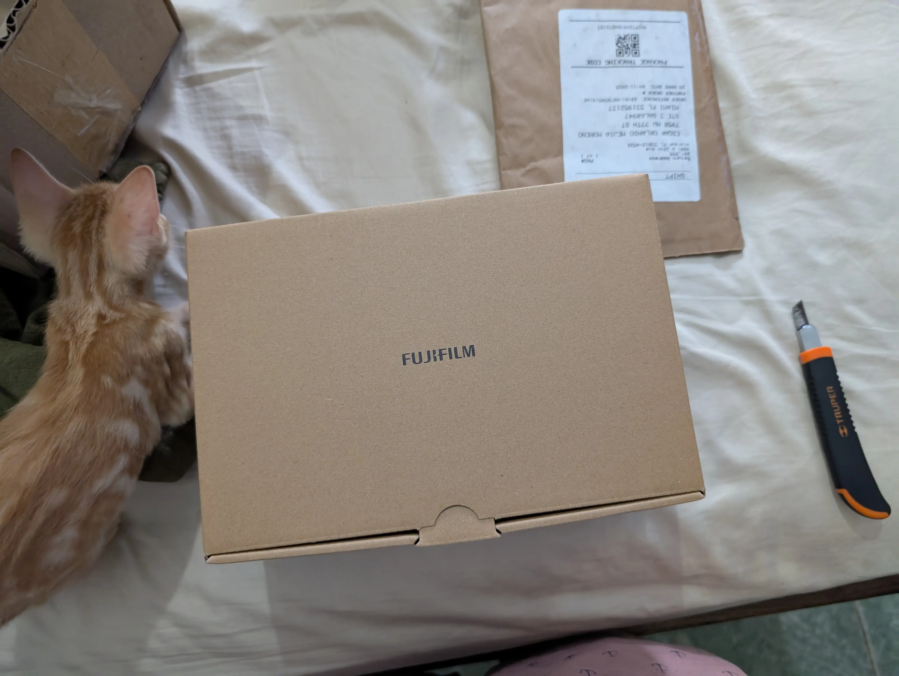
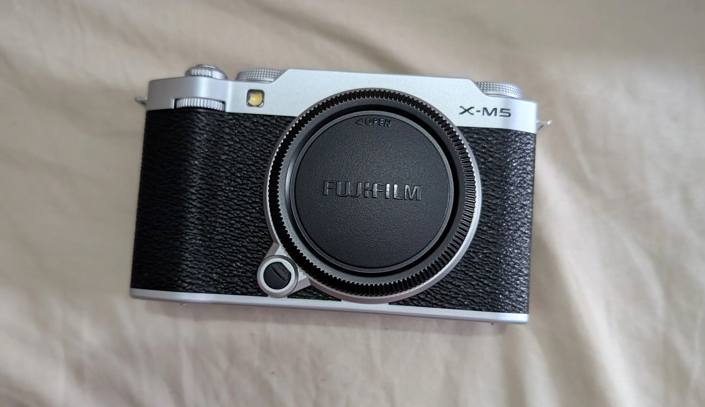
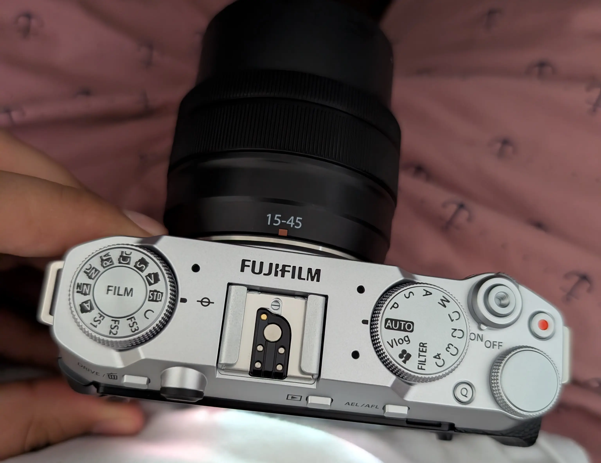
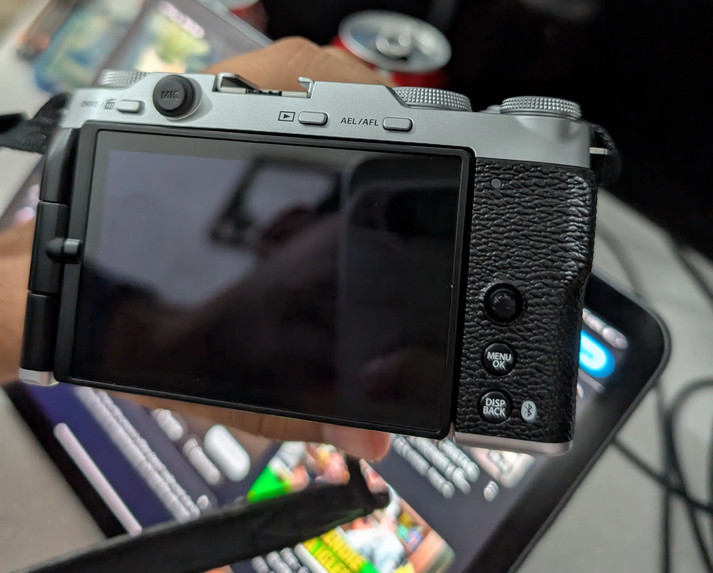
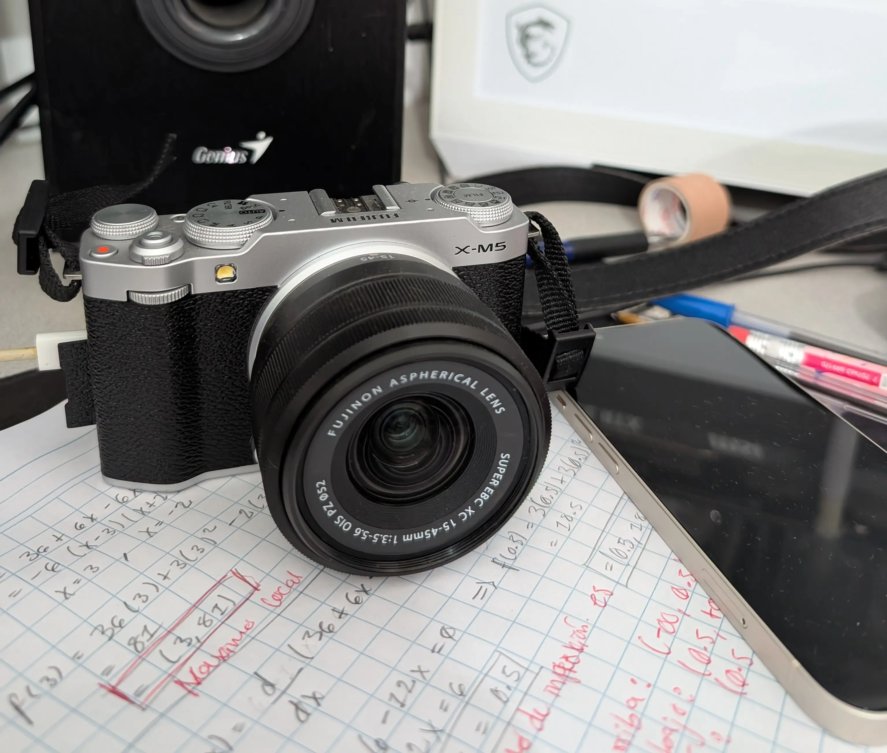
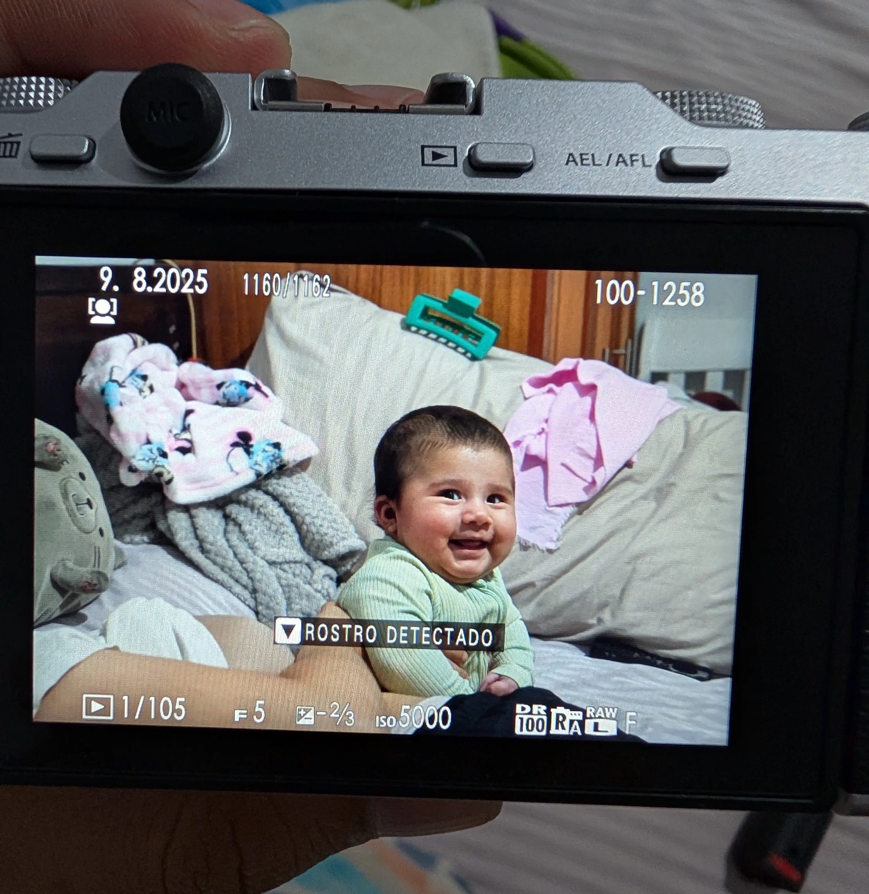

## Por qué una cámara

No soy fotógrafo. Hasta ahora, todas mis fotos eran con el celular. Pero mi hija está creciendo muy rápido y quería algo especial para guardar esos momentos, fotos que pueda ver en veinte años y que me sigan gustando.

También quería una cámara para viajar fuera del país. Las fotos del celular están bien, pero quería algo que me hiciera detenerme y mirar de verdad el lugar que estoy visitando.

## Unboxing

La cámara llegó en abril del 2025. Mi gato revisó la caja antes de que yo pudiera abrirla.

Elegí la plateada porque parece una cámara de rollo antigua. Sinceramente, eso pesó mucho en la decisión.

## Aprendiendo sobre la marcha

Tiene muchos diales y botones, y todavía no sé qué hacen la mayoría. Mi favorito es el de la izquierda: cambia los colores de la foto para que parezca de rollo. Lo giro hasta que me gusta lo que veo.

El otro dial tiene un modo Auto y, para ser honesto, ahí se queda casi siempre.

La pantalla se abre hacia el lado, lo que ayuda mucho cuando estoy en el suelo sacándole fotos a mi hija.

## Lo mejor

Es pequeña y liviana, así que de verdad la llevo conmigo. Vive en mi escritorio, lista para salir.

Y esta es la razón por la que la compré.

